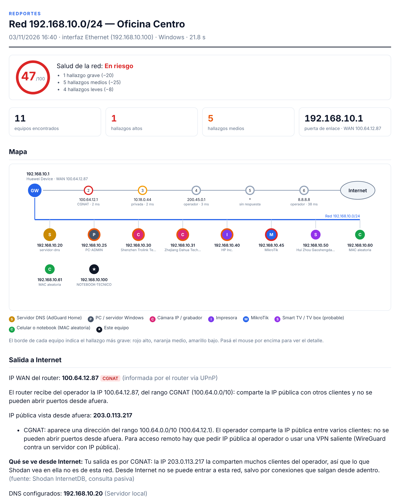

# Redportes

**Escáner de red local para técnicos de campo.** Llegás a un cliente, nadie sabe qué hay conectado: corrés `redportes` y en un minuto tenés el mapa de la red, qué es cada equipo, qué conviene revisar (explicado en castellano y con qué hacer) y un informe listo para guardar como PDF.

Libre, gratis y de código abierto (MIT). Funciona en **Linux, Windows y macOS**.



> Mirá un informe completo con datos inventados en [`ejemplos/informe-ejemplo.html`](ejemplos/informe-ejemplo.html) (descargalo y abrilo en el navegador).

## Qué hace

- **Mapa de la red**: de Internet al router y del router a cada equipo.
- **Qué es cada aparato**: IP, MAC, fabricante, nombre, sistema estimado, puertos abiertos y título de su panel web. Distingue routers, MikroTik, Ubiquiti, cámaras y grabadores, impresoras, teléfonos IP, servidores Windows/Linux/Proxmox, máquinas virtuales, Raspberry Pi y celulares (MAC aleatoria).
- **Qué conviene revisar**, con explicación y solución:
  Telnet, SMBv1, FTP, paneles web sin HTTPS, RDP y VNC, API de MikroTik sin cifrar, Winbox abierto, PPTP, bases de datos expuestas, NFS, cámaras en la red general y UPnP activo en el router.
- **Cómo sale a Internet** (opcional, con `--internet`): saltos hasta Internet, **doble NAT**, **CGNAT**, IP pública y qué DNS usa.
- **Visitas por cliente**: guarda cada escaneo y en la siguiente visita te dice qué equipos son nuevos, cuáles ya no están y qué puertos se abrieron o cerraron.
- **Informe HTML** autocontenido (no carga nada de Internet) con botón *Guardar como PDF*.

## Qué NO hace

- No instala agentes ni modifica nada en los equipos.
- No prueba contraseñas ni explota vulnerabilidades.
- No necesita permisos de administrador (con ellos y con nmap obtiene más MACs).
- No envía nada a Internet salvo que uses `--internet` o `actualizar-oui`.

> ⚠️ **Usalo solo en redes donde tengas autorización.** Un escaneo de puertos puede disparar alertas en firewalls o equipos de seguridad: si hay un equipo de ciberseguridad, avisale antes.

## Instalación

### Windows (con interfaz gráfica)

Bajá el instalador `Redportes-x.y.z-instalador.exe` de la sección [Releases](https://github.com/Fracunzera/Redportes/releases/latest) y ejecutalo. No pide permisos de administrador ni necesita Python. Queda en el menú Inicio como **Redportes**.

> Como el instalador no está firmado digitalmente, Windows puede mostrar *«Windows protegió su PC»*: tocá **Más información → Ejecutar de todas formas**.

Los informes se guardan en `Documentos\Redportes`.

### Línea de comandos (Linux, Windows, macOS)

Necesitás Python 3.9 o superior.

```bash
# Recomendado: con pipx queda como comando aislado
pipx install git+https://github.com/Fracunzera/Redportes

# O con pip
pip install git+https://github.com/Fracunzera/Redportes
```

Esto instala también `redportes-gui`, la misma interfaz gráfica (en Linux necesita el paquete `python3-tk`).

**Opcional pero recomendado:** instalar [nmap](https://nmap.org/download.html) (`sudo apt install nmap`). Redportes lo usa para el descubrimiento si está; si no, todo funciona igual con Python puro (ping, TCP y tabla ARP).

**Opcional:** bajar la base completa de fabricantes de la IEEE (unos 5 MB, una sola vez):

```bash
redportes actualizar-oui
```

Sin eso usa la base de nmap si está instalado, o una lista mínima incorporada (MikroTik, Ubiquiti, Hikvision, Dahua, Raspberry Pi, virtualización…).

## Redes grandes

El ping se hace sin lanzar procesos (socket ICMP en Linux/macOS, API nativa en Windows), así que una /16 lleva del orden de un minuto en Linux y unos pocos en Windows, más el tiempo de revisar puertos en los equipos que respondan. Hasta una /16 no pide confirmación; para redes más grandes hay que agregar `--forzar`. Con más de 96 equipos el mapa del informe los agrupa por /24.

La MAC y el fabricante solo se pueden obtener de los equipos del mismo segmento de red (los que ve la tabla ARP). En subredes ruteadas el tipo de equipo se estima por puertos, banners y TTL.

## Uso

```bash
# Escanea la red de la interfaz principal con 21 puertos comunes y genera el informe
redportes

# Con nombre de cliente (para el historial), todos los puertos y análisis de salida a Internet
redportes -c "Ferretería El Tornillo" -p completo --internet --abrir

# Una red puntual o puertos a elección
redportes -r 10.0.5.0/24 -p 22,80,443,8000-8100

# Ver interfaces, visitas guardadas y regenerar un informe viejo
redportes interfaces
redportes visitas -c "Ferretería El Tornillo"
redportes informe 3 --abrir
```

| Opción | Qué hace |
|---|---|
| `-r, --red` | Red a escanear (por defecto la de la interfaz principal) |
| `-i, --interfaz` | Interfaz a usar |
| `-p, --puertos` | `rapido` (21), `completo` (36), `ninguno` o lista `22,80,8000-8010` |
| `-c, --cliente` | Nombre del cliente/sitio, para comparar visitas |
| `--internet` | Analiza la salida a Internet (traceroute + IP pública) |
| `-o, --salida` | Nombre del HTML |
| `--json` | Guarda el resultado crudo en JSON |
| `--abrir` | Abre el informe al terminar |
| `--sin-nmap` | No usar nmap |
| `--no-guardar` | No guardar en el historial |
| `--forzar` | Permite redes más grandes que una /16 |

En Linux, para que nmap traiga las MAC de todos los equipos: `sudo redportes …` (sin sudo igual las saca de la tabla ARP del sistema).

El historial se guarda en `~/.local/share/redportes/visitas.db` (Linux), `%LOCALAPPDATA%\redportes` (Windows) o `~/Library/Application Support/redportes` (macOS).

## Cómo funciona

| Parte | Técnica |
|---|---|
| Descubrimiento | `nmap -sn` (si está) + barrido de ping propio + toque TCP en redes chicas + tabla ARP |
| Fabricante | Prefijo de la MAC (IEEE / nmap / lista incorporada); detecta MAC aleatorias |
| Sistema | TTL del ping, banners de SSH/FTP/Telnet y puertos característicos |
| Puertos | Conexión TCP completa, sin privilegios; lee el `<title>` de las webs |
| SMBv1 | Ofrece solo el dialecto SMBv1 y mira si el equipo lo acepta (sin autenticar) |
| UPnP | Un M-SEARCH SSDP y escucha quién responde |
| Doble NAT / CGNAT | Traceroute: dos saltos privados seguidos = doble NAT; un salto en 100.64.0.0/10 = CGNAT |

## Desarrollo

```bash
git clone https://github.com/Fracunzera/Redportes && cd Redportes
pip install -e ".[dev]"
pytest
python ejemplos/generar_ejemplo.py /tmp/ejemplo.html   # informe con datos de prueba
```

Las reglas de hallazgos están en [`redportes/hallazgos.py`](redportes/hallazgos.py) y la clasificación de equipos en [`redportes/clasificacion.py`](redportes/clasificacion.py): son el mejor lugar para contribuir.

## Ideas para próximas versiones

- Prueba de velocidad opcional.
- Descubrimiento por mDNS, NetBIOS, LLDP/CDP y SNMP (solo lectura).
- Varias subredes / VLANs en un mismo informe.
- Panel web opcional y autoalojado para juntar los informes de todos tus clientes.

## Licencia

[MIT](LICENSE). Usalo, modificalo y redistribuilo libremente.
